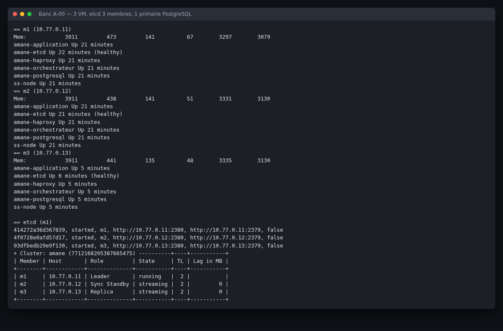

# BANC-VM — Trois machines virtuelles réelles (KVM, sans root)

Tâche A-00. Banc de test de la pile PME sur de **vraies machines** : noyaux
séparés, extinction électrique réelle possible, partition réseau réelle,
mémoire et CPU mesurés à l'intérieur de chaque machine. Rien de tout cela
n'est visible depuis des conteneurs.

Le banc ne remplace pas la pile en service (`amane-*` sur l'hôte, qu'on ne
touche jamais) ni `ha-lab` (tests destructifs en conteneurs) : il sert aux
tests de machine — bascule, perte de quorum, coupure réseau — dans des
conditions proches d'une PME réelle.

---

## 1. Topologie

```
           HÔTE (sans root) — QEMU 11.1.2, /dev/kvm (crw-rw-rw-)
                    │
   ┌────────────────┼───────────────────┐
   │ NAT QEMU (user)│  commutateur      │   tout le stockage dans
   │ ens3, DHCP     │  virtuel sans     │   /mnt/data/amane-bench/
   │ Internet via   │  root : -netdev   │   (overlay qcow2 20 Go/VM)
   │ l'hôte         │  socket mcast     │
   │ hostfwd SSH/web│  127.0.0.1:7777   │
   ▼                ▼                   ▼
┌─────────┐     ┌─────────┐         ┌─────────┐
│   m1    │     │   m2    │         │   m3    │
│ actif   │     │ passif  │         │ passif  │
│ .11     │◄───►│ .12     │◄───────►│ .13     │
└─────────┘     └─────────┘         └─────────┘
   LAN du banc : 10.77.0.0/24 (ens4, IP fixes)
```

Chaque VM est une Ubuntu 22.04 (jammy-server-cloudimg, SHA256 vérifié dans
`/mnt/data/vm-tp4/SHA256SUMS`, image **ne pas retélécharger**) avec :

| Paramètre | valeur |
|---|---|
| RAM | 4096 Mo |
| vCPU | 2 (`-cpu host`, KVM) |
| disque | overlay qcow2 20 Go sur l'image de base |
| utilisateur | `etudiant` (sudo NOPASSWD, clé SSH, `ssh_pwauth: false`) |
| `ens3` | DHCP sur le NAT QEMU (10.0.2.15) — apt, docker, téléchargements |
| `ens4` | IP fixe LAN : m1 `10.77.0.11`, m2 `10.77.0.12`, m3 `10.77.0.13` |
| MAC | `ens3` 52:54:00:10:77:1N, `ens4` 52:54:00:20:77:1N (N = 1/2/3) |
| PCI | NIC à `addr=0x3` et `addr=0x4` → noms **stables** `ens3`/`ens4` |
| SSH hôte | `127.0.0.1:2211` (m1), `:2212` (m2), `:2213` (m3) |
| Web hôte | `127.0.0.1:9011` (m1), `:9012` (m2), `:9013` (m3) → port 9001 |

Le netplan de chaque machine (produit par cloud-init depuis
`network-config`) vise `ens3`/`ens4` avec correspondance par MAC et
`set-name` — jamais `enp0s3`.

## 2. Commandes

```bash
# créer / démarrer (idempotent) : disques, seeds, QEMU, attente SSH,
# netplan, ping croisé m1→m2, m2→m3, m3→m1
tools/bench/create-bench.sh

# déployer Docker + les 6 images + la pile PME (idempotent)
tools/bench/deploy-pile.sh

# vérifier de bout en bout (lecture seule : 3 VM, réseau, etcd, Patroni,
# ss-node, application, images) — sort 1 au premier échec
tools/bench/verify-bench.sh

# arrêter les trois VM et supprimer leurs disques (journaux et captures
# conservés dans /mnt/data/amane-bench/logs et /captures)
tools/bench/destroy-bench.sh

# SSH d'une machine
ssh -i /mnt/data/amane-bench/cle-bench -p 2211 etudiant@127.0.0.1   # m1
```

Lancement QEMU (par VM, `-daemonize -pidfile`) — celui de m1 :

```
qemu-system-x86_64 -name amane-bench-m1 -enable-kvm -cpu host \
  -m 4096 -smp 2 \
  -drive file=/mnt/data/amane-bench/m1/disk.qcow2,if=virtio,format=qcow2 \
  -drive file=/mnt/data/amane-bench/m1/seed.iso,format=raw,if=virtio,readonly=on \
  -netdev user,id=n0,hostfwd=tcp:127.0.0.1:2211-:22,hostfwd=tcp:127.0.0.1:9011-:9001 \
  -device virtio-net-pci,netdev=n0,mac=52:54:00:10:77:11,addr=0x3 \
  -netdev socket,id=n1,mcast=230.0.0.1:7777,localaddr=127.0.0.1 \
  -device virtio-net-pci,netdev=n1,mac=52:54:00:20:77:11,addr=0x4 \
  -display none -monitor unix:/mnt/data/amane-bench/m1/monitor.sock,server,nowait \
  -pidfile /mnt/data/amane-bench/m1/qemu.pid \
  -serial file:/mnt/data/amane-bench/logs/m1-serial.log -daemonize
```

## 3. Pile PME sur le banc

La pile est déployée depuis **le gabarit du dépôt**
(`templates/tenants/docker-compose.yml.tmpl`), rendu par
`tools/bench/render-compose.py` avec le contexte de la pile de test publiée
(`tools/bench/pile-bench.json`). Le rendu est vérifié par le script :
**identique à la pile en service** (`/opt/amane-pme/docker-compose.yml`,
horodatage d'en-tête près) — donc mêmes images épinglées par digest, même
application hébergée (listmonk).

Par machine, dans `~/amane-pme/` : `docker-compose.yml` (le même partout) et
un `.env` propre :

| variable | m1 | m2 | m3 |
|---|---|---|---|
| `NODE_IP` | 10.77.0.11 | 10.77.0.12 | 10.77.0.13 |
| `NODE_HOSTNAME` | m1 | m2 | m3 |
| `NODE_MODE` | **active** | passive | passive |
| `SAAS_URL` | http://10.77.0.11:5173 (portail factice sur m1) | idem | idem |
| `RELAY_URL` | http://10.77.0.254:8080 (IP du banc, sans service) | idem | idem |
| `REGISTRATION_TOKEN` | (jeton du tenant de la pile de test) | idem | idem |

Ordre d'amorçage contrôlé par `deploy-pile.sh` : m1 crée le cluster etcd,
m2 le rejoint, m3 le rejoint — le portail factice (`tools/bench/
portail-mock.py`, service systemd `amane-portail-mock` sur m1) renvoie la
liste des machines « déjà installées » au moment voulu, exactement comme le
portail réel (`GET /api/devices/cluster-status/`, `POST /api/devices/register/`,
même contrat que `orchestrator-go/portail/portail.go`).

Images chargées **sans registre** depuis l'hôte :
`docker save <id> | gzip | ssh … 'gunzip | docker load'` pour etcd,
postgresql, orchestrateur, haproxy, noeud, listmonk. Les images locales
portent leur référence épinglée (`repo@sha256:…`) comme tag ; elle survit à
save/load, le compose du banc résout donc chaque référence localement
(`--pull never` interdit tout tirage réseau).

## 4. État final (mesuré le 2026-11-25 à 18:13)

Sortie brute : `docs/tests/artifacts-a00/verification-banc.log`
(`tools/bench/verify-bench.sh`), captures en fin de document.

| Élément | Mesure |
|---|---|
| VM | **3** QEMU/KVM démarrées (pids 2825663, 2825692, 2825742), `-m 4096 -smp 2`, disques qcow2 4,0 / 4,0 / 3,9 Go sous `/mnt/data/amane-bench/mN/` |
| Dans chaque VM | `nproc` = 2 (Intel i5-10200H), `MemTotal` 3911 Mo, 402 à 473 Mo réellement utilisés au repos |
| Réseau | `ens3` = 10.0.2.15/24 (DHCP NAT) sur les trois ; `ens4` = 10.77.0.11/24, .12/24, .13/24 |
| Ping croisé LAN | m1→m2 moy. **0,801 ms**, m2→m3 **0,822 ms**, m3→m1 **0,581 ms**, 0 % de perte (5 paquets) |
| etcd | **3 membres `started`** (m1 414272a3, m2 4f0728e0, m3 93dfbedb), raft term 3, index appliqué identique sur les trois (4856 au premier relevé, 4862 au dernier) ; `endpoint health --cluster` : 3/3 sains (4,4 / 4,6 / 10,0 ms de proposition au dernier relevé) |
| Patroni | **1 primaire** : m1 `Leader running` (TL 2) ; m2 `Sync Standby streaming` (lag 0) ; m3 `Replica streaming` (lag 0) |
| ss-node | `running` sur les trois ; m1 `mode Active` (« prise de rôle primaire consignée », époque 2), m2/m3 `mode Passive`, tous « Patroni : supervision en lecture » et « Cluster : sain (époque 2) » |
| Application | servie par m1 : `http://127.0.0.1:9011/` → **200** (listmonk, 1436 octets), `/health` → `{"data":true}` ; 9012 et 9013 répondent aussi 200 (mêmes services vus depuis m2/m3) |
| Docker | **29.10.1** dans les trois VM, `docker run --rm hello-world` OK |
| Images | 6 références épinglées par VM, **IDs identiques à l'hôte (18/18 comparaisons)** — voir `artifacts-a00/images-digests.txt` |
| Pile en service (hôte) | non modifiée : `amane-haproxy`, `amane-orchestrateur`, `amane-postgresql` `Up 4 days`, `amane-etcd` `Up 4 days (unhealthy)`, `amane-application` `Restarting (1)` — état dégradé **antérieur** à la tâche (cf. `docs/STATE.md`) |



*État final : les trois VM, leurs six conteneurs, les trois membres etcd et la
liste Patroni (un Leader, un Sync Standby, un Replica).*


*L'application listmonk servie par m1 sur `http://127.0.0.1:9011/` (NAT de ens3).*


## 5. Écarts constatés par rapport à la recette et à la pile

1. **Commutateur virtuel en mode multicast, pas `listen`/`connect`.** La
   recette validée (`-netdev socket,listen=127.0.0.1:7777` sur m1,
   `connect` sur m2 et m3) ne tient que pour **deux** machines : le mode
   `listen` du socket netdev QEMU n'accepte qu'une seule connexion, la
   troisième reste dans le backlog d'acceptation sans jamais transporter un
   paquet (vérifié expérimentalement : la connexion TCP de m3 reste ESTAB
   côté client mais n'est jamais acceptée par QEMU). Pour trois machines sur
   un segment sans root, le même `socket` netdev est utilisé en mode
   **mcast** (`mcast=230.0.0.1:7777,localaddr=127.0.0.1` sur les trois VM) :
   segment Ethernet unique 10.77.0.0/24, mêmes latences (mesures §4).
2. **Portail factice.** Le portail réel (100.64.0.6) est injoignable depuis
   l'hôte au moment du déploiement ; `amane-init` exige la liste des machines
   déjà installées (sinon il abandonne au bout de 10 min : « liste des
   machines indisponible »). Le banc embarque donc un portail factice
   (contrat HTTP identique) et les `.env` pointent `SAAS_URL` sur lui.
   Aucune ligne du gabarit n'est modifiée : seule la valeur de `SAAS_URL`
   change, comme pour une vraie PME.
3. **`RELAY_URL` sans service** (10.77.0.254, IP du banc) : le relais réel
   est celui de l'éditeur, hors du banc. ss-node tolère un relais
   injoignable (la pile en service tourne depuis 4 jours dans cet état).
4. **pgadmin non chargé.** Le brief prescrit six images (etcd, postgresql,
   orchestrateur, haproxy, noeud, listmonk) : le service pgadmin est retiré
   du compose du banc par `render-compose.py --sans-pgadmin` (service
   facultatif de consultation ; la pile elle-même n'en dépend pas).
5. **Port hôte 90NN→9001 ajouté** au NAT (en plus du 22NN→:22 de la
   recette) pour observer l'application servie par m1 depuis l'hôte ;
   rien d'autre ne change sur `ens3`.
6. **Écart de « digest » à connaître.** Les digests épinglés par la pile
   (cf. `tenants/pile.py`, `scripts/publier-pile.sh`) sont les **config
   digests** (ID d'image), pas des digests de manifeste de registre :
   `docker image inspect <ref>` montre `Id == digest épinglé`, et le tag
   local est littéralement `repo@sha256:<ID>`. Conséquence : la référence
   épinglée se résout localement (aucun registre requis) et le contenu est
   **identique octet par octet** à ce que la pile attend. Seul piège :
   `docker load` ne recrée pas ce tag (une référence contenant `@sha256`
   est refusée comme tag) — l'image arrive « moby-dangling@<id> » et
   `deploy-pile.sh` restitue la référence par containerd
   (`sudo ctr -n moby images tag`, sudo *dans la VM*) ; la vérification
   automatique compare ensuite l'ID de chaque image entre l'hôte et la VM
   (aucun écart de contenu, cf. §6).
7. **Clé SSH dédiée au banc** (`/mnt/data/amane-bench/cle-bench`, générée
   par `create-bench.sh`) : les clés de l'hôte sont protégées par passphrase
   (inutilisables en BatchMode) et `/mnt/data` est monté fuseblk
   (permissions forcées 0777, ssh refuse la clé). La clé privée est donc
   utilisée via une copie 0600 dans `/tmp/opencode/amane-bench-cle`.
8. **Docker à l'intérieur des VM via sudo** : la recette impose
   `get.docker.com`, qui exige root *dans la VM* ; le sudo NOPASSWD de
   `etudiant` (cloud-init, recette validée) est utilisé uniquement là.
   Aucun sudo sur l'hôte.

## 6. Vérifications (commandes et résultats mesurés)

Rejouer l'ensemble : `tools/bench/verify-bench.sh` (lecture seule, sort 1 au
premier contrôle en échec). Résultat de la dernière exécution : **0 contrôle en
échec** (`docs/tests/artifacts-a00/verification-banc.log`).

| # | Commande exacte | Résultat attendu | Constaté |
|---|---|---|---|
| 1 | `kill -0 $(cat /mnt/data/amane-bench/mN/qemu.pid)` (N=1..3) | 3 processus vivants | 3/3 vivants |
| 2 | `grep -o '\-m [0-9]*' /proc/<pid>/cmdline` | `-m 4096` | 4096 pour les trois |
| 3 | `ssh … m1 'ip -4 -br addr show ens4'` | `10.77.0.11/24` | idem (.12, .13 sur m2, m3) |
| 4 | `ssh … m1 'ping -c 5 10.77.0.12'` | 0 % de perte | 0 % (0,80 ms moy.) |
| 5 | `ssh … m2 'ping -c 5 10.77.0.13'` et `m3 'ping -c 5 10.77.0.11'` | 0 % de perte | 0 % (0,82 / 0,58 ms) |
| 6 | `ssh … m1 'docker exec amane-etcd etcdctl member list'` | 3 lignes `started` | m1, m2, m3 `started` |
| 7 | `ssh … m1 'docker exec amane-etcd etcdctl endpoint health --cluster'` | 3 `is healthy` | 3/3 |
| 8 | `ssh … mN 'docker exec amane-postgresql python3 -c "…/patroni…[role]"'` | 1 `primary`, 2 `replica` | m1 primary, m2/m3 replica |
| 9 | `ssh … m1 'docker exec amane-postgresql patronictl list'` | Leader + 2 réplicas, lag 0 | Leader m1, Sync Standby m2, Replica m3, lag 0 |
| 10 | `ssh … mN 'docker inspect -f {{.State.Status}} ss-node'` | `running` | 3/3 `running` |
| 11 | `curl -s -o /dev/null -w '%{http_code}' http://127.0.0.1:9011/` | `200` | 200 |
| 12 | `curl -s http://127.0.0.1:9011/health` | réponse de l'application | `{"data":true}` |
| 13 | `docker image inspect <ref> --format {{.Id}}` hôte vs `ssh … docker image inspect <ref>` | identiques | 18/18 identiques |
| 14 | `ssh … mN 'docker run --rm hello-world'` | `Hello from Docker!` | OK sur les trois (journal `logs/mN-prep.log`) |
| 15 | `tools/bench/deploy-pile.sh` (relancé 2 fois) | exit 0 | exit 0 (`artifacts-a00/deploy-pile-2.log`, `deploy-pile-3.log`) |
| 16 | `tools/bench/create-bench.sh` (relancé) | idempotent : rien recréé | « déjà démarrée » ×3, seeds intacts (mtime inchangé), pings OK (`artifacts-a00/create-bench-idempotence.log`) |

Deux pièges de mesure rencontrés et traités dans les scripts :

- **Rôle Patroni** : sur cette image, `GET /` répond **503** pour un réplica ;
  le rôle se lit sur `GET /patroni` (200 pour primaire et réplica). Le contrôle
  `deploy-pile.sh` a été corrigé en conséquence (l'ancien contrôle ne pouvait
  pas réussir sur un réplica : il bloquait jusqu'au délai).
- **Suivi de ss-node** : l'état se lit dans `docker logs ss-node` (mode
  Active/Passive, « Patroni : supervision en lecture », « Cluster : sain »),
  pas par HTTP (le nœud sert l'application à la racine et sa console sous
  `/amane`). Relevé : `artifacts-a00/ss-node-roles.txt`.

## 7. Journaux et captures

- `tools/bench/create-bench.sh` : sortie dans `/mnt/data/amane-bench/logs/`
- console série de chaque VM : `/mnt/data/amane-bench/logs/mN-serial.log`
- installation Docker / chargement d'images : `/mnt/data/amane-bench/logs/mN-prep.log`
  (cumulatif : un marqueur `=== exécution … ===` sépare les lancements ;
  l'origine des paquets est relevée dans
  `docs/tests/artifacts-a00/docker-installation.txt` : `docker-ce
  5:29.10.1-1~ubuntu.22.04~jammy`, `containerd.io 2.4.2`, dépôt Docker ajouté
  par `get.docker.com`)
- portail factice : `/mnt/data/amane-bench/logs/` et `~/portail/serveur.log` sur m1
- vérification reproductible : `tools/bench/verify-bench.sh`
  (`docs/tests/artifacts-a00/verification-banc.log`)
- copies datées des journaux de cette session : `docs/tests/artifacts-a00/`
  (`deploy-pile-2.log`, `deploy-pile-3.log`, `create-bench-idempotence.log`,
  `images-digests.txt`, `ss-node-roles.txt`, `docker-installation.txt`,
  `env-m1.txt` sans jetons)
- captures : `docs/tests/captures/banc-vm-etat-final.png`,
  `docs/tests/captures/banc-vm-application-m1.png`
