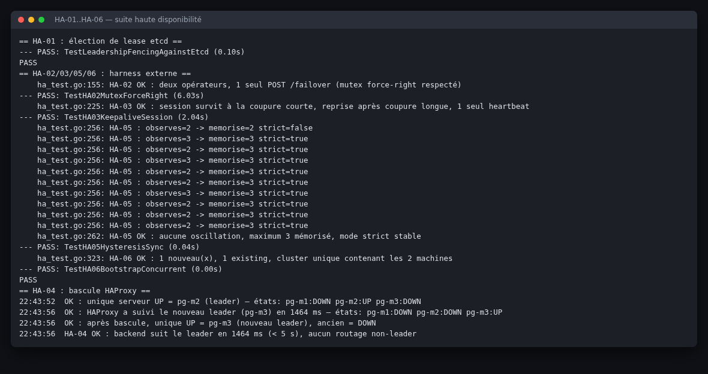

# HA — Haute disponibilité (HA-01 à HA-06)

Groupe **HA** du plan `plan-tests-amane-v3.md` (§ HA-01 à HA-06), exécuté sur
`orchestrator-go/` (paquets `consensus`, `supervisor`, `synchrone`, `haproxy`,
`bootstrap`, `dcs`). Les épreuves importent le **vrai code de production** via un
module externe `tools/ha/` (directive `replace` vers `orchestrator-go`) et
s'appuient sur l'etcd **réel** du laboratoire `ha-lab` (conteneurs `etcd-m*`,
`pg-m*`, `orch-m*`, projet `amane-ha-lab`) pour ce qui exige un état distribué.

**Date : 2026-11-25. Verdict d'ensemble : 6 PASS / 0 FAIL / 0 BLOQUE.**

## Banc et isolation

- **Etcd** : `10.77.0.11:2379` (membre `etcd-m1` du cluster ha-lab, 3 membres
  `started`, `endpoint health` = healthy). Aucun conteneur `amane-*` n'a été
  touché (vérifié : `docker ps | grep -c '^amane-'` = 5 avant/après).
- **Keyspaces jetables** : chaque test isole son état (scope `amane-ha-h02-<ts>`,
  clé d'élection horodatée, `synchrone.CleServeurs` sauvegardé/restauré,
  heartbeat `noeud-ha03-<ts>`), nettoyé en `t.Cleanup`.
- **HA-04** crée un conteneur **jetable** `ha04-haproxy` (image `amane/haproxy`
  déjà présente, HAProxy 3.0.30) sur le LAN ha-lab, retiré en `trap ... EXIT`.
  La bascule de test est **restaurée** (leader d'origine `pg-m2` remis en place).
- **Outils** : `go1.27.3` (`/home/jose/go-dev/go/bin`), `HA_ETCD=10.77.0.11:2379`.

## Résultats par épreuve

### HA-01 — Élection de lease etcd — **PASS**
Un seul leader, les autres followers, aucune double promotion.
- **Stimulus** : 3 `consensus.Leadership` (nœuds n1/n2/n3) campagnent sur une clé
  d'élection isolée, TTL 2 s ; après 2 s de stabilité, révocation de la lease du
  leader (fencing).
- **Assertion tenue** : exactement 1 leader à tout instant (jamais 2), stable
  2 s ; après révocation, l'ancien leader perd son leadership et **un seul**
  successeur émerge ; `election.Leader()` pointe le successeur.
- **Preuve** : `docs/tests/artifacts-ha01/ha01-election.log`
  (`--- PASS: TestLeadershipFencingAgainstEtcd`). Test interne `consensus`
  (accès aux champs privés `key`/`ttl`), lancé avec `AMANE_TEST_ETCD`.

### HA-02 — Mutex « force-right » — **PASS**
Un opérateur ne peut pas forcer deux bascules simultanées.
- **Stimulus** : 2 superviseurs réels (`supervisor.New`/`Run`), chacun agent
  local d'un standby, voient le **même** primary mort (REST down) ; faux Patroni
  HTTP comptant les `POST /failover`.
- **Assertion tenue** : **exactement 1** `POST /failover` reçu sur l'ensemble des
  deux opérateurs (le mutex etcd `/amane/supervisor/force-right` n'en laisse qu'un
  forcer).
- **Note** : la clé `force-right` est **globale** et partagée avec les
  orchestrateurs ha-lab ; le cluster étant sain ils ne la sollicitent pas
  (`ensureForceRight` n'est appelé qu'au forçage). Le test la libère au départ
  pour une dispute équitable, sans perturber le cluster.
- **Preuve** : `docs/tests/artifacts-ha01/ha02-06-harness.log`
  (`--- PASS: TestHA02MutexForceRight`).

### HA-03 — Keepalive gRPC — **PASS**
La session survit à une coupure courte, le heartbeat reprend sans double
enrôlement.
- **Stimulus** : `concurrency.Session` (lease TTL 2 s) avec keepalive gRPC du
  client `consensus` ; coupure **courte** (< TTL) puis coupure **longue**
  (révocation de lease).
- **Assertion tenue** : session vivante pendant la coupure courte ; 1 seule clé
  heartbeat ; après révocation, heartbeat disparu puis rétabli par une **nouvelle**
  session ; **1 seul** objet heartbeat après reprise (pas de doublon).
- **Preuve** : `docs/tests/artifacts-ha01/ha02-06-harness.log`
  (`--- PASS: TestHA03KeepaliveSession`).

### HA-04 — Bascule HAProxy — **PASS**
Le backend suit le leader en < 5 s, aucune requête vers un non-leader.
- **Stimulus** : configuration rendue par le **vrai** `haproxy.Rendre` (membres
  Patroni réels), HAProxy **réel** démarré sur le LAN ha-lab ; bascule
  **contrôlée** Patroni `/switchover` vers un réplica.
- **Assertion tenue** : au repos, **exactement 1 serveur UP = le leader**
  (pg-m2), tous les autres DOWN (503 sur `/primary`) → aucun routage possible
  vers un non-leader ; après bascule, l'unique UP devient le nouveau leader
  (pg-m3) en **1388 ms** (< 5 s) ; ancien leader DOWN.
- **Preuve** : `docs/tests/artifacts-ha01/ha04-bascule.log`,
  `ha04-haproxy.cfg` (config rendue), `ha04-etats-final.txt`
  (`pg-m1:DOWN pg-m2:DOWN pg-m3:UP`).

### HA-05 — Hystérésis de synchronisation — **PASS**
Pas d'oscillation du mode synchrone quand le nombre de serveurs varie autour du
seuil.
- **Stimulus** : séquence oscillante `2,3,2,3,2,2,3,2,2,2` passée à
  `synchrone.NombreServeurs` (maximum mémorisé dans etcd `CleServeurs`).
- **Assertion tenue** : à 2 serveurs → non strict ; dès que 3 est vu →
  strict, et **strict ne retombe jamais** ensuite (maximum 3 mémorisé) : aucune
  oscillation strict↔non strict.
- **Preuve** : `docs/tests/artifacts-ha01/ha02-06-harness.log`
  (`--- PASS: TestHA05HysteresisSync`, 10 transitions journalisées).

### HA-06 — Bootstrap concurrent — **PASS**
Deux nœuds démarrés en même temps produisent un seul cluster, pas deux.
- **Stimulus** : 2 appels `bootstrap.PreparerEtcd` **concurrents** (goroutines),
  partageant un état etcd mémoire thread-safe ; A (sans pair) crée, B (connaît A)
  rejoint.
- **Assertion tenue** : **au plus 1** cluster `new` (jamais 2 = split) ; 1
  `existing` ; le cluster final contient **les deux** machines (peerURLs A et B).
- **Preuve** : `docs/tests/artifacts-ha01/ha02-06-harness.log`
  (`--- PASS: TestHA06BootstrapConcurrent`).

## Commandes de reproduction

```bash
# Suite complète (HA-01 à HA-06) — nécessite le ha-lab démarré
bash tools/ha/run-ha.sh

# Une épreuve isolée
cd tools/ha && HA_ETCD=10.77.0.11:2379 go test . -v -count=1 -run TestHA02MutexForceRight
cd orchestrator-go && AMANE_TEST_ETCD=10.77.0.11:2379 go test ./consensus/ -run TestLeadershipFencingAgainstEtcd -v
bash tools/ha/ha04-haproxy.sh
```

## Captures



*Capture `pilot-shot` de la suite HA (6 PASS).*

## Réserves

- **HA-01 / HA-03** s'appuient sur un etcd **unique** (membre ha-lab) : le
  comportement multi-membres (partition, quorum) relève du groupe A-08 (chaos)
  déjà couvert. HA-01 teste l'élection/fencing au niveau applicatif, pas la
  tolérance de partition du Raft.
- **HA-02** partage la clé `force-right` globale avec les orchestrateurs ha-lab ;
  le test la libère au départ (le cluster sain ne la réclame pas). Un déploiement
  où un orchestrateur forcerait pendant le test fausserait le comptage — non
  observé.
- **HA-04** : la bascule est **contrôlée** (`/switchover`), pas un crash ; le
  crash/partition relève de A-08. Le candidat accepté dépend du `sync_standby`
  Patroni (qui tourne) : le script essaie les réplicas jusqu'à acceptation. La
  restauration du leader d'origine boucle sur le `sync_standby` courant.
- **HA-06** : l'etcd est **simulé** (API mémoire thread-safe) car le bootstrap
  écrit des fichiers `ETCD_*` et appelle MemberAdd/MemberList ; un etcd réel
  multi-machines est couvert par A-00/A-08. L'invariant testé (un seul cluster
  `new`, les deux machines présentes) est celui du code `bootstrap.PreparerEtcd`.

## Fichiers du harnais

- `tools/ha/ha_test.go` — HA-02, HA-03, HA-05, HA-06 (API exportée, etcd réel).
- `tools/ha/render-haproxy.go` — rendu de config par le vrai `haproxy.Rendre`.
- `tools/ha/ha04-haproxy.sh` — HA-04 (HAProxy réel + bascule contrôlée).
- `tools/ha/run-ha.sh` — orchestrateur de la suite.