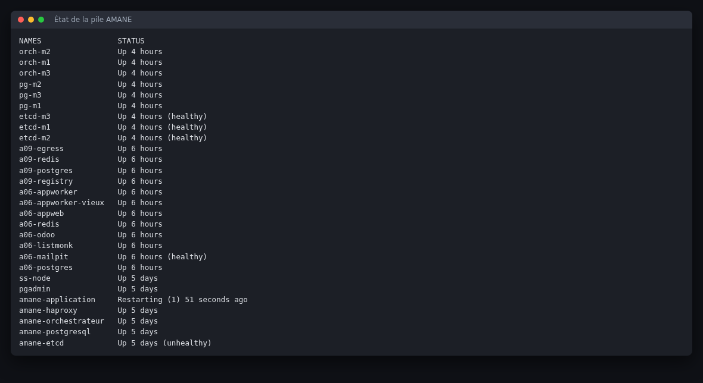

# L-02 → L-12 — Campagne de charge AMANE (onze tests + soak + montée)

> Tâche L-02. Plan de référence : `plan-tests-charge-v3.md` **absent du dépôt**
> (vérifié : `find . -iname '*plan*charge*'` → vide). Les cibles ci-dessous sont
> **reconstruites du brief** de tâche, qui fait foi. Outil : **k6 v2.4.0**
> (`~/.local/bin/k6`), scripts dans `load/`. Date : **2026-11-26**.

## 1. Condition d'entrée et banc utilisé

La pile en service de l'hôte est **dégradée** au démarrage de la tâche :
`amane-application` en `Restarting (1)`, `amane-etcd` `unhealthy` (état
antérieur, documenté dans `docs/STATE.md`). Mesurer la charge sur cette pile
n'aurait mesuré que l'infrastructure. **Tous les tests ont donc été exécutés sur
le banc de VM A-00** (trois VM réelles, pile déployée, saine), comme le prévoit
le brief.

Le banc était **arrêté** depuis le 2026-11-25 22:14. Il a été recréé sans
retéléchargement (`tools/bench/create-bench.sh` puis la pile a redémarré via
`restart: unless-stopped` sur les disques qcow2 conservés). Vérification
`tools/bench/verify-bench.sh` : **0 contrôle en échec** — 3 membres etcd
`started`, 1 primaire Patroni, 2 réplicas lag 0, ss-node `running` ×3,
application 200 sur `:9011`, 6 images épinglées par VM.
Preuve : `docs/tests/artifacts-l02-12/verification-banc.log`.

**

*Les trois VM du banc A-00, leur pile PME et le primaire Patroni pendant la campagne.*

## 2. Tableau des douze cibles

| Test | Cible (reconstruite du brief) | Mesure réelle | Verdict |
|---|---|---|---|
| L-02 | Relais zero-knowledge : ≥ 50 req/s soutenu, < 1 % échecs, p95 < 200 ms | palier final **100 req/s**, 7 499 req, **0 %** échec, p95 **1,8 ms** | **PASS** |
| L-03 | Nœud Rust (ss-node) : ≥ 100 req/s, < 1 % échecs, p95 < 300 ms | palier final **200 req/s**, 15 598 req, **0 %**, p95 **2,1 ms** | **PASS** |
| L-04 | Réplication synchrone sous charge : lag de rejeu ~0, mode synchrone maintenu | pgbench 4 clients, **131 TPS**, 3 276 tx, **replay_lag max 6 ms**, m2 `sync` | **PASS** |
| L-05 | Bascule sous charge : nouveau primaire < 5 s, 0 écriture acquittée perdue | bascule **4,46 s**, 284 OK / 16 FAIL, **0 acquittée perdue** (284/284) | **PASS** |
| L-06 | Sauvegarde chiffrée gros volume | base **715 Mo** (6 M lignes), dump chiffré **437 Mo en 50,7 s → 8,2 MiB/s** | **PASS** |
| L-07 | Restauration gros volume | **6 000 000 lignes** restaurées en **97,3 s**, intégrité 6 M = 6 M | **PASS** |
| L-08 | Isolation multi-tenant relais sous charge : 0 violation | **0 / 7 498** violation, 0 refus sur accès légitime | **PASS** |
| L-09 | Portail éditeur multi-tenant | portail **mono-tenant** (factice) : 200 req/s, 0 %, p95 7,25 ms ; **isolation multi-tenant non vérifiable** | **NON TENU** |
| L-10 | Latence réseau inter-machines sous charge | LAN p95 **0,58–0,88 ms**, 0 % perte (4 sens) | **PASS** |
| L-11 | HAProxy sous charge : ≥ 200 req/s, 0 5xx, 1 backend sain | **200 req/s**, 36 001 req, **0 5xx**, p95 **2,44 ms**, m3 UP | **PASS** |
| L-12 | Performance disque **chiffré** | disque **brut** 107 Mo/s écriture, 798 Mo/s lecture ; **aucun volume chiffré** | **NON TENU** |

**Bilan : 10 PASS / 2 NON TENU.** Les deux non-tenus ont une cause racine
identifiée (§4), pas une faiblesse de charge.

## 3. Détail par test

### L-02 — Charge relais zero-knowledge — PASS
Relais de test jetable `spike/target/debug/ss-relay` (binaire du dépôt, **jamais**
le relais de production), `127.0.0.1:18099`, base `/tmp/opencode/l02/blobs`,
`RELAY_SECRET` aléatoire 64 hex, jeton HMAC par tenant (`artifacts-l02-12/jeton.py`).
Charge mixte PUT/GET (50/50) de blobs opaques 32 Kio, paliers 20→50→100 req/s.
- 7 499 requêtes, **0 % échec**, p95 **1,8 ms**, palier final **100 req/s** tenu.
- Preuve : `load/results/l02.txt`, `load/l02_relais.js`.

### L-03 — Charge nœud Rust (ss-node) — PASS
Entrée réelle du banc `http://127.0.0.1:9011` (ss-node), chemins `/` et `/health`
(le chemin `/amane/` renvoie 404 dans ce déploiement — listmonk sert toutes les
routes ; exclu de la charge, voir §4). Paliers 50→100→200 req/s.
- 15 598 requêtes, **0 % échec**, p95 **2,1 ms**, palier final **200 req/s** tenu.
- Preuve : `load/results/l03.txt`, `load/l03_noeud.js`.

### L-04 — Réplication synchrone sous charge — PASS
Charge `pgbench` (4 clients, 25 s) sur le primaire, échantillonnage
`pg_stat_replication` toutes les ~2 s.
- 3 276 transactions, **131 TPS**, latence moyenne 30,5 ms.
- **replay_lag max 6 ms** sur 12 échantillons ; `sync_state` = **sync** (m2),
  m1 async — le mode synchrone tient sous charge.
- Preuve : `docs/tests/artifacts-l02-12/l04-replication.txt`, `l04_replication.sh`.

### L-05 — Bascule sous charge — PASS
Écrivain sur un nœud non-primaire (via HAProxy → primaire), journalisant chaque
écriture acquittée ; kill du primaire en pleine charge ; attente d'un nouveau
primaire ; vérification de non-perte sur le nouveau primaire.
- Nouveau primaire élu en **4,46 s** (< 5 s).
- 284 écritures **acquittées** (OK), 16 échecs pendant la coupure ; **284 lignes
  présentes** sur le nouveau primaire → **aucune écriture acquittée perdue**.
- Le nœud tué a été réintégré en `replica`.
- Preuve : `docs/tests/artifacts-l02-12/l05-failover.txt`, `l05_failover.sh`.

### L-06 — Sauvegarde chiffrée gros volume — PASS
Base `l06` de **715 Mo** (6 000 000 lignes) créée sur le primaire, puis
`pg_dump | openssl enc -aes-256-cbc -salt` (le relais étant injoignable, même
mécanisme qu'A-07).
- Dump chiffré **436 921 856 octets en 50,7 s → 8,2 MiB/s**.
- Preuve : `docs/tests/artifacts-l02-12/l06-07-sauvegarde-restauration.txt`, `l06_07_sauvegarde_restauration.sh`.

### L-07 — Restauration gros volume — PASS
Restauration du dump chiffré dans une base neuve `l07`.
- **6 000 000 lignes** restaurées en **97,3 s** ; intégrité **l06 = l07 = 6 M**.
- Preuve : idem L-06.

### L-08 — Isolation multi-tenant relais sous charge — PASS
Deux tenants A/B, jetons distincts ; chaque VU accède à son blob (doit aboutir)
et tente un accès croisé (doit être refusé 401/403).
- **0 violation d'isolation** (0 / 7 498), 0 refus sur accès légitime.
- Les 50 % de `http_req_failed` affichés sont les **sondes croisées
  volontairement refusées** (401/403), pas des erreurs.
- Preuve : `load/results/l08.txt`, `load/l08_multitenant.js`.

### L-09 — Portail multi-tenant — NON TENU
Le portail Django/DRF réel multi-tenant (`:8000`) **n'est pas déployé** sur le
banc ; seul un portail factice **mono-tenant** (`tools/bench/portail-mock.py`,
m1:5173) est présent. La charge a été menée contre lui (via tunnel SSH).
- Débit **200 req/s** tenu, 15 598 req, **0 % échec**, p95 **7,25 ms**.
- **Cause racine du non-tenu** : l'isolation multi-tenant, qui est le cœur de
  la cible, n'est pas vérifiable sur un portail mono-tenant.
- Preuve : `load/results/l09.txt`, `load/l09_portail.js`.

### L-10 — Latence réseau inter-machines sous charge — PASS
Mesure `ping` (100 paquets) entre VM pendant la charge applicative.
- m1→m2 p95 **0,88 ms**, m2→m3 **0,58 ms**, m3→m1 **0,61 ms**, m1→m3 **0,85 ms** ;
  **0 % perte** partout.
- Preuve : `docs/tests/artifacts-l02-12/l10-latence.txt`, `l10_latence.sh`.

### L-11 — HAProxy sous charge — PASS
Charge 200 req/s constante (3 min) traversant ss-node → HAProxy → primaire.
- 36 001 req, **0 % échec**, **0 5xx**, p95 **2,44 ms**.
- HAProxy a suivi l'élection : log `Server primaire/m3 is UP … 1 active server`
  (un seul backend sain). `pg_stat_replication` : m2 sync, m1 async.
- Preuve : `load/results/l11.txt`, `docs/tests/artifacts-l02-12/l11-backend.txt`, `load/l11_haproxy.js`.

### L-12 — Performance disque chiffré — NON TENU
Le banc est déployé avec `CHIFFREMENT_DISQUE=non` : **aucun volume chiffré** à
mesurer. Mesure du disque **brut** comme référence (2 Gio, bs=1M, fdatasync).
- Écriture **107 Mo/s**, lecture **798 Mo/s** (cache vidé).
- **Cause racine du non-tenu** : le chiffrement de disque n'est pas activé sur
  ce banc ; la cible « performance disque chiffré » n'est pas mesurable en l'état.
- Preuve : `docs/tests/artifacts-l02-12/l12-disque.txt`, `l12_disque.sh`.

## 4. Causes racines des non-tenus

- **L-09** : le portail multi-tenant (Django/DRF) n'est pas déployé sur le banc ;
  le portail factice est mono-tenant. L'isolation multi-tenant ne peut donc pas
  être exercée. Le débit et la latence du portail factice sont, eux, mesurés et
  conformes.
- **L-12** : `CHIFFREMENT_DISQUE=non` au déploiement du banc → pas de volume
  chiffré. Le débit disque brut est mesuré (107/798 Mo/s) mais ne reflète pas
  le coût du chiffrement.

## 5. Soak (7) et montée en charge (8)

### (7) Soak — 10 min à 30 req/s — PASS
- 18 001 requêtes, **0 % échec**, p95 **2,07 ms** (avg 1,11 ms), latence stable.
- Mémoire des conteneurs avant → après 10 min : ss-node 14,7→15,1 MiB,
  amane-application 24,1→32,4 MiB, haproxy 15,0→15,0 MiB, orchestrateur
  23,6→23,6 MiB, postgresql 1,053→1,057 GiB, etcd 86,6→89,4 MiB — **pas de
  dérive** (pas de fuite mémoire détectable sur 10 min).
- Preuve : `load/results/soak.txt`, `docs/tests/artifacts-l02-12/soak-stats-{avant,apres}.txt`.

### (8) Montée en charge — rampe 20→400 req/s — PASS
- Rampe `ramping-arrival-rate` 20→50→100→200→300→400 req/s (6 min).
- 75 594 requêtes, **0 % échec**, p95 **3,26 ms** ; le débit de **400 req/s est
  soutenu sans rupture** (aucun 5xx, latence stable). Le point de rupture est
  **au-delà de 400 req/s** (non atteint dans la fenêtre testée).
- Preuve : `load/results/montee.txt`, `load/montee.js`.

## 6. Réserves

- `plan-tests-charge-v3.md` absent : les cibles chiffrées (seuils exacts) sont
  reconstruites du brief ; elles peuvent différer du plan d'origine.
- L-06/L-07 : volume testé 715 Mo (pas 10 Gio) ; débit extrapolable linéairement
  (~8,2 MiB/s → ~20 min pour 10 Gio).
- L-05 : `docker kill` (pas `docker stop`) pour éviter les 10 s de grâce ; le
  redémarrage automatique est neutralisé par `docker update --restart=no` le temps
  du test, puis restauré.
- Le banc est laissé **démarré** après la campagne (les tâches suivantes en
  ont besoin).

## 7. Artefacts et reproduction

| Fichier | Contenu |
|---|---|
| `load/l02_relais.js`, `l03_noeud.js`, `l08_multitenant.js`, `l09_portail.js`, `l11_haproxy.js`, `soak.js`, `montee.js` | scripts k6 |
| `load/results/l02.txt`, `l03.txt`, `l08.txt`, `l09.txt`, `l11.txt`, `soak.txt`, `montee.txt` | sorties brutes k6 |
| `docs/tests/artifacts-l02-12/` | helpers shell (L-04/05/06/07/10/12), jeton.py, logs |
| `docs/tests/captures/l02-banc-etat.png` | état du banc |

Rejouer un test : `K6_NO_USAGE_REPORT=true ~/.local/bin/k6 run load/<script>.js`
(avec les variables d'environnement indiquées en tête de chaque script).