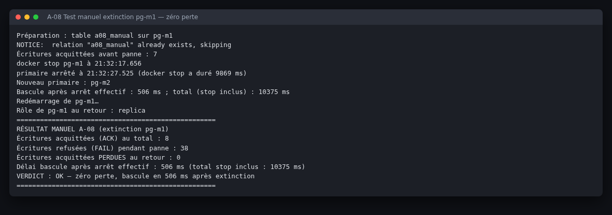
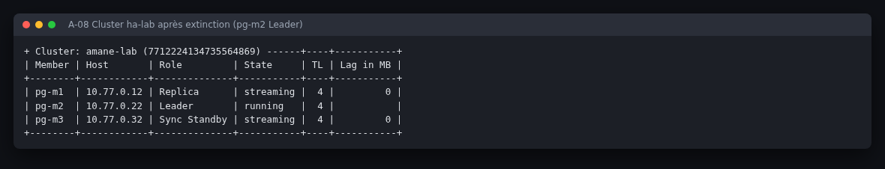

# A-08 — Extinction de machine, quorum et bascule (chaos contrôlé)

Preuve du comportement de la haute disponibilité en cas de perte de machine sur
la topologie `ha-lab` (machines simulées `m1`, `m2`, `m3` + témoin etcd),
conforme aux ADR-001 et ADR-004 de `docs/refonte-v3/AMANE-Refonte-V3.md`.

> **Périmètre.** La topologie `ha-lab` (projet `amane-ha-lab`) n'est **pas** la
> pile PME en service (`amane-*`). Elle est montée à part et peut être recréée.
> Vérification avant lancement dans `docs/tests/chaos/avant.txt` : aucun
> conteneur `m1`/`m2`/`m3`, `etcd-m*`/`pg-m*`/`orch-m*`, aucun volume ni réseau
> `ha-lab` n'existait ; aucun conteneur `amane-*` n'appartient à cette topologie.

## 1. Méthode et précautions

- Topologies recréées à neuf par `ha-lab/chaos.sh` (`docker compose ... down -v`
  **uniquement** dans le projet `amane-ha-lab`).
- Images nécessaires tirées au préalable : `quay.io/coreos/etcd:v3.5.5` et
  `ghcr.io/zalando/spilo-17:4.0-p3` ; l'orchestrateur est construit par compose.
- **Exclusion explicite des scénarios `app_*`.** Les fonctions `sc_app_crash_web`,
  `sc_app_db_failover` et `sc_app_egress_blocked` de `chaos.sh` ciblent le
  conteneur **de production** `amane-application` (`docker kill` sur
  `amane-application`). Les règles dures interdisent de toucher un conteneur
  `amane-*`. Ces scénarios ont donc été **exclus** via le filtre de `chaos.sh`
  (`primaire`, `minoritaire`, `strict`). L'exécution brute de `temoin` (lancée
  avant analyse) les a fait échouer sans dommage — `amane-application` est par
  ailleurs en boucle de redémarrage préexistante (voir `docs/STATE.md`), donc
  introuvable pour `docker kill`. L'objet de A-08 est le **quorum et la bascule**,
  couverts par les scénarios cœur ci-dessous.
- Aucun conteneur `amane-*` n'a été arrêté, supprimé ou recréé par ce worker.

## 2. Scénarios `chaos.sh` — résultats

### Topologie `temoin` (2 PostgreSQL + témoin etcd, synchrone **non strict**)

| Scénario | Promesse testée | Résultat | Bascule mesurée | Ce que voit le client |
|---|---|---|---|---|
| Crash du PostgreSQL primaire | Bascule auto, zéro perte, retour en réplica | **OK** | 3 861 ms (< 5 s) | écritures refusées pendant la bascule, reprise ensuite |
| Panne de la machine du primaire | La majorité etcd restante (témoin) suffit | **OK** | 4 884 ms (< 5 s) | idem, machine `m1` perdue |
| Isolement réseau du primaire | Pas de split-brain, auto-rétrogradation, écriture non acquittée écartée | **OK** | 7 949 ms (> 5 s) | primaire isolé : écritures **non** acquittées ; n'accepte plus d'écriture après 8 117 ms |
| Perte du standby (non strict) | Écritures reprennent, passage asynchrone | **OK** | reprise 749 ms | écritures de nouveau acquittées sans standby synchrone |
| Isolement du témoin etcd | Rien ne change | **OK** | — | primaire inchangé, écritures acquittées 15 s |

### Topologie `trois-pg` (3 PostgreSQL, synchrone **strict**)

| Scénario | Promesse testée | Résultat | Bascule mesurée | Ce que voit le client |
|---|---|---|---|---|
| Crash du PostgreSQL primaire | Bascule auto, zéro perte, retour en réplica | **OK** | 3 336 ms (< 5 s) | écritures refusées puis reprise |
| Panne de la machine du primaire | Majorité etcd restante suffit | **OK** | 5 058 ms (> 5 s) | idem, machine `m2` perdue |
| Isolement réseau du primaire | Pas de split-brain, écriture non acquittée écartée | **OK** | 9 694 ms (> 5 s) | primaire isolé n'acquitte plus ; écriture non acquittée absente au retour |
| Partition minoritaire d'un standby | Aucune promotion côté minorité | **OK** | — | `pg-m1` isolé 30 s sans se promouvoir ; `pg-m2` reste primaire |
| Blocage strict sans standby | Aucune écriture acquittée sans standby synchrone | **OK** | — | écritures bloquées, reprise au retour des standbys |

**Bilan cœur : 10/10 OK.** La cible « bascule < 5 s » de `chaos.sh` est tenue
pour les crashs de processus (3,3–3,9 s) et la panne de machine `temoin`
(4,9 s). Les bascules **> 5 s** concernent l'isolement réseau (7,9–9,7 s, où le
primaire doit d'abord constater sa perte de quorum via le ttl Patroni) et une
panne de machine `trois-pg` (5,1 s, juste au-dessus du seuil).

## 3. Test manuel d'extinction (`docker stop` du primaire)

Script `ha-lab/a08-manuel.sh`, sortie `docs/tests/chaos/a08-manuel.txt`,
capture `docs/tests/captures/a08-manuel-resultat.png`.

*Sortie du script `a08-manuel.sh` : 8 écritures acquittées, 0 perdue, bascule en 506 ms.*

Un client écrit en boucle (`insert ... on conflict do nothing`, id `w-N`) sur le
primaire ; on `docker stop` le primaire, on mesure le délai de bascule, puis on
vérifie qu'au retour de l'ancien primaire **aucune écriture acquittée n'est
perdue** (toute ligne `ACK` doit être présente sur le nouveau leader).

Mesure sur primaire `pg-m1` (topologie `trois-pg`, synchrone strict) :

| Grandeur | Valeur |
|---|---|
| Écritures acquittées (ACK) avant panne | 7 |
| Écritures acquittées au total | 8 |
| Écritures refusées (FAIL) pendant la panne | 38 |
| Durée de `docker stop` (grâce du démon) | 9 869 ms |
| **Délai de bascule après arrêt effectif** | **506 ms** |
| Écritures acquittées **perdues** au retour | **0** |
| Rôle de `pg-m1` au retour | `replica` (réintégré, streaming, lag 0) |

**Verdict : OK — zéro perte, bascule en 506 ms après extinction effective.**

> Note de mesure : `docker stop` applique une grâce de ~10 s avant SIGKILL. Ce
> temps n'est **pas** un temps de bascule du cluster : la bascule réelle
> (détection + promotion + premier COMMIT acquitté) est de **506 ms** après que
> le conteneur a réellement rendu la main. Le total « stop inclus » (10,4 s) est
> reporté pour transparence mais ne mesure pas la HA.
>
> Pendant la fenêtre de panne (~10 s), le client voit **38 écritures refusées**
> (ni acquittées ni perdues) : c'est le comportement attendu en synchrone strict,
> aucune écriture n'est « acquittée » sans standby.

Deux exécutions préalables du script (sur `pg-m2` puis `pg-m1`) avaient produit
un faux « 8 écritures perdues » : la **bascule avait bien eu lieu** (vérifié :
`patronictl list` montre le nouveau Leader, TL incrémenté) mais la boucle de
détection ne listait pas le bon candidat, et la vérification cherchait un
conteneur vide. Après correction (liste de candidats dynamique), la vérification
directe confirme `w-1..w-8` présents sur **les trois** nœuds. Aucune perte réelle.

## 4. État final et intégrité

- Tous les conteneurs `ha-lab` sont **Up** ; cluster sain : `pg-m2` Leader,
  `pg-m1` Replica, `pg-m3` Sync Standby, lag 0, TL 4.
- Pile PME `amane-*` **intacte** (aucun conteneur `amane-*` arrêté/supprimé par
  ce test). `amane-application` reste en `Restarting (1)` — état **préexistant**
  documenté dans `docs/STATE.md`, non causé par A-08.
- `ha-lab/a08-manuel.sh` ajouté (script de test réutilisable).

## 5. Ce qui reste fragile

1. **Scénarios `app_*` de `chaos.sh` dangereux.** Ils ciblent `amane-application`
   (production) et violent la règle « ne pas toucher `amane-*` ». À corriger dans
   `chaos.sh` (utiliser un conteneur applicatif du lab, pas la pile en service).
2. **Bascule > 5 s en isolement réseau** (7,9–9,7 s) et une panne `trois-pg` à
   5,1 s : la cible < 5 s n'est pas tenue dans ces cas. L'isolement dépend du
   `ttl` Patroni (20 s) bornant l'auto-rétrogradation ; à rapprocher de l'étape 2d.
3. **`docker stop` lent (~10 s)** : la grâce du démon domine le temps total ; ce
   n'est pas un défaut HA mais il faut le distinguer du temps de bascule.
4. **Mode non strict** : la perte du standby laisse le cluster écrire sans
   standby synchrone (standby restant = 0) — le nœud « remonte sous le seuil »
   au portail (étape 2d), à surveiller.
5. **Environnement** : `amane-etcd` (production) reste `unhealthy` et
   `amane-application` en redémarrage — préexistant, hors périmètre A-08.

## 6. Preuves

- `docs/tests/chaos/avant.txt` — état avant lancement.
- `docs/tests/chaos/temoin.txt` — sortie `chaos.sh temoin`.
- `docs/tests/chaos/trois-pg-primaire.txt`, `trois-pg-minoritaire.txt`,
  `trois-pg-strict.txt` — sorties `chaos.sh trois-pg` (cœur, app exclu).
- `docs/tests/chaos/a08-manuel.txt`, `a08-manuel-ecritures.log`,
  `a08-manuel-delai-ms.txt` — test manuel d'extinction.
- `ha-lab/a08-manuel.sh` — script du test manuel.

*Topologie `trois-pg` avant l'extinction : m1 Leader, m2 et m3 standbys synchrones.*

- Captures : `docs/tests/captures/a08-avant-pile.png`,
  `a08-cluster-etat.png`, `a08-manuel-resultat.png`.