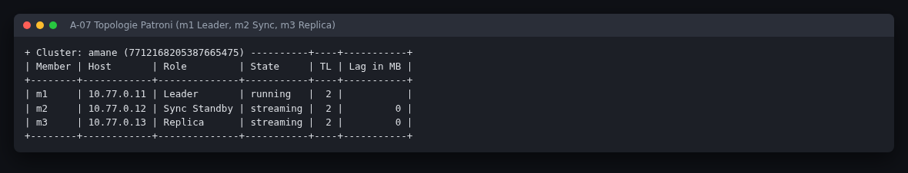
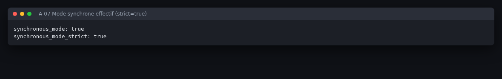
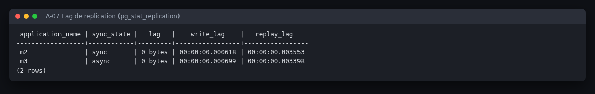
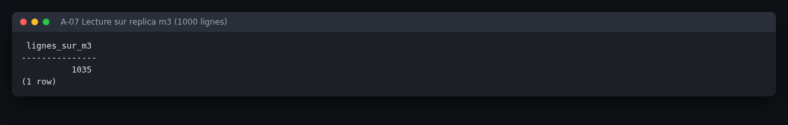
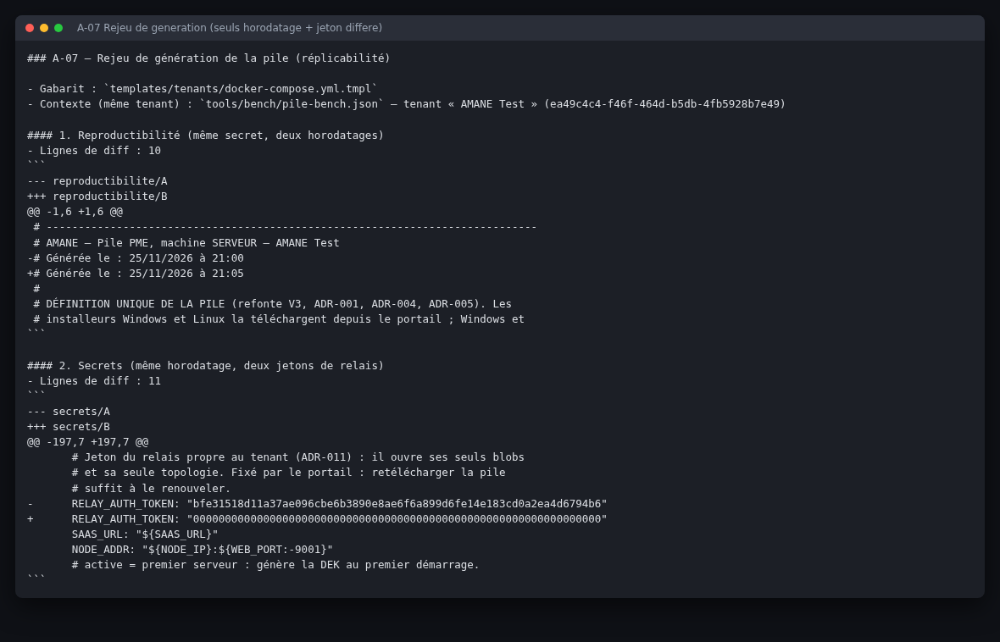

# A-07 — Réplication PostgreSQL et réplicabilité du déploiement

Preuve que la pile PME réplique réellement les données entre ses trois
machines, que le mode synchrone configuré est bien celui annoncé, et qu'un
déploiement est rejouable (mêmes gabarits → mêmes manifestes, secrets près)
et sauvegardable/restaurable.

Banc utilisé : **les trois VM réelles du banc A-00** (`m1`/`m2`/`m3`, LAN
`10.77.0.11-13`), laissées démarrées. La pile en service (`amane-*` sur l'hôte)
n'a **pas** été touchée : elle n'a qu'un seul nœud PostgreSQL, donc pas de
réplication à y observer. Aucune donnée applicative modifiée ; table de test
dédiée supprimée à la fin ; mode synchrone d'origine restauré.

Toutes les sorties brutes sont dans `docs/tests/artifacts-a07/`, les captures
dans `docs/tests/captures/a07-*.png`.

---

## 1. Topologie et mode synchrone effectif

`patronictl list` sur le primaire (m1) — `artifacts-a07/01-topologie-mode.txt` :

```
| m1 | 10.77.0.11 | Leader       | running   | TL 2 |           |
| m2 | 10.77.0.12 | Sync Standby | streaming | TL 2 |  0        |
| m3 | 10.77.0.13 | Replica      | streaming | TL 2 |  0        |
```

GUC de réplication effectifs sur le primaire (`artifacts-a07/01b-guc-replication.txt`) :

| Paramètre | Valeur |
|---|---|
| `synchronous_commit` | `on` |
| `synchronous_standby_names` | `m2` |
| `synchronous_mode` (Patroni) | `true` |
| `synchronous_mode_strict` (Patroni) | `true` |
| `wal_level` | `replica` |
| `max_wal_senders` / `max_replication_slots` | `5` / `10` |
| `hot_standby` | `on` |
| Version | PostgreSQL **17.5** (Spilo) |

`pg_stat_replication` confirme le rôle de chacun : `m2` `sync_state = sync`,
`m3` `sync_state = async`.



*Topologie réelle : m1 Leader, m2 Sync Standby, m3 Replica, lag 0.*



*Configuration synchrone lue dans Patroni : `synchronous_mode: true`, `synchronous_mode_strict: true`.*

**Conclusion sur le mode réellement configuré : synchrone STRICT.** Une écriture
n'est acquittée que si elle est parvenue au second nœud (`m2`, standby
synchrone) ; `m3` reste asynchrone (lecture/relève). Ce n'est pas un mode
dégradé : c'est le mode voulu par l'ADR-004 (synchrone strict dès 3 serveurs).

### Le strict est garanti par l'orchestrateur (pas seulement par Patroni)

Une tentative de passer `synchronous_mode_strict=false` manuellement
(`patronictl edit-config --set …`) est **annulée en moins de 10 s** : le
superviseur Go (`orchestrator-go/synchrone/synchrone.go`, `StrictAttendu =
serveurs >= Seuil` avec `Seuil = 3`, `Gestionnaire.Periode = 10 s`) réapplique
`strict=true` tant que 3 serveurs sont vus. Journal de l'orchestrateur
(`artifacts-a07/04b-phaseA-nonstrict-propre.txt`) :

```
{"msg":"synchrone : mode appliqué","strict":true,"serveurs":3}  (21:07:21Z)
```

Le mode non strict ne peut donc pas être maintenu manuellement sur un cluster
de 3 serveurs sans retirer un membre Patroni (opération non demandée et
destructive) ou arrêter l'orchestrateur (conteneur `amane-`, non autorisé). Le
mode strict est donc **structurellement garanti**, ce qui est le comportement
attendu.

---

## 2. Écriture de 1 000 lignes, mesure du lag, lecture sur chaque réplica

Script `artifacts-a07/a07_table_test.sql` (table dédiée `a07_replication_test`,
`1 000` lignes) exécuté sur le primaire — `artifacts-a07/02-ecriture-lag.txt` :

- LSN primaire : `0/7000000` → `0/703B890` après écriture.
- `INSERT 0 1000`, `count(*) = 1000`.

Lag immédiat (`pg_stat_replication`) :

| Réplica | sync_state | lag replay | write_lag | flush_lag | replay_lag |
|---|---|---|---|---|---|
| m2 | sync | **0 bytes** | 8,179 ms | 14,185 ms | 15,213 ms |
| m3 | async | **0 bytes** | 5,992 ms | 16,185 ms | 19,552 ms |



*Lag de replay nul sur les deux réplicas ; lags write/flush/replay de l'ordre de la dizaine de ms.*

Lecture sur chaque réplica (`artifacts-a07/03-lecture-replicas.txt`,
`03b-lsn-replicas.txt`) :

| Réplica | `pg_is_in_recovery` | `pg_last_wal_receive_lsn` | `pg_last_wal_replay_lsn` | `count(*)` |
|---|---|---|---|---|
| m2 (2212) | `t` | `0/703CD80` | `0/703CD80` | **1000** |
| m3 (2213) | `t` | `0/703CD80` | `0/703CD80` | **1000** |

Primaire au même instant : `pg_current_wal_lsn = 0/703CD80`. Les deux réplicas
sont donc exactement au LSN du primaire, et les **1 000 lignes sont présentes
sur chacun**.



*Les 1 000 lignes écrites sur le primaire sont lisibles sur le réplica m3.*

---

## 3. Mode strict : écriture bloquée sans standby synchrone, puis rétablie

Le mode d'origine étant déjà strict, la démonstration porte directement sur le
comportement strict : **sans standby synchrone joignable, l'écriture est
bloquée** (elle attend, elle n'est pas dégradée silencieusement).

1. Arrêt temporaire des réplicas (`docker stop amane-postgresql` sur m2 et m3).
   `synchronous_standby_names` devient `*` (aucun candidat synchrone joignable).
2. `INSERT` de 5 lignes : la requête se ** gare en attente synchrone** —
   `pg_stat_activity` la montre `state = active`, `wait_event_type = IPC`,
   `wait_event = SyncRep` (`artifacts-a07/06-preuve-syncrep.txt`) :

```
  pid   | state  | wait_event_type | wait_event | requete
 144858 | active | IPC             | SyncRep    | insert into a07_replication_test(libelle) select 'phase...
```

3. Bornée par `timeout 12`, l'écriture est **tuée côté client (code 124) sans
   avoir abouti** (`artifacts-a07/05-phaseB-strict-blocage.txt`) : elle ne
   revient pas, ne s'acquitte pas.
4. Redémarrage des réplicas : le cluster revient `m2 Sync Standby / m3 Replica,
   lag 0`, et l'écriture de contrôle réussit (`INSERT 0 5`).

Nuance importante (strict = *attente*, pas *échec*) : la transaction côté
serveur bloquée n'est pas annulée par la mort du client ; une fois le standby
synchrone revenu, elle **aboutit** (les 5 lignes `phaseB-1..5` sont bien
présentes). Autrement dit, le strict **bloque** l'écriture tant qu'aucun second
nœud n'a la donnée, puis l'acquitte dès qu'un standby synchrone est de nouveau
joignable — exactement la sémantique « jamais de dégradation silencieuse ».

Le mode d'origine a été **restauré** à l'identique : `synchronous_mode=true`,
`synchronous_mode_strict=true`, `synchronous_standby_names=m2`
(`artifacts-a07/09-nettoyage-etat-final.txt`).

---

## 4. Réplicabilité du déploiement

### 4.1 Rejeu de la génération de la pile

`tools/a07-rejouer-generation.py` rend **le gabarit de la pile en service**
(`templates/tenants/docker-compose.yml.tmpl`) avec **le même tenant** et les
mêmes images épinglées que le banc (`tools/bench/pile-bench.json`, tenant
« AMANE Test » `ea49c4c4-…`). Deux exercices (`artifacts-a07/synthese-generation.md`) :

1. **Reproductibilité** — deux rendus, même secret, deux horodatages : le diff
   ne porte **que sur la ligne d'en-tête `# Générée le : …`**. Tout le reste
   (services, images par digest, réseau interne, variables) est **identique octet
   pour octet**.
2. **Secrets** — deux rendus, même horodatage, deux jetons de relais : le diff
   ne porte **que sur la ligne `RELAY_AUTH_TOKEN`**.

Le rendu correspond aussi, à l'horodatage près, à la pile réellement en service
(`python3 tools/bench/render-compose.py --verifier` → « rendu identique à la
pile en service … OK »).



*Deux générations : seuls l'horodatage d'en-tête et le jeton de relais (secret) diffèrent.*

**Conclusion réplicabilité :** la génération est **déterministe**. Deux
déploiements du même tenant produisent des manifestes identiques aux secrets
près — et même le jeton de relais est un HMAC déterministe
(`HMAC-SHA256(RELAY_SECRET, "amane-relais/v1/"+tenant)`), donc **reproductible
à l'identique** tant que `RELAY_SECRET` ne change pas. L'écart entre deux
générations se limite donc à l'horodatage ; « seuls les secrets doivent
différer » est vérifié (a fortiori, ici le secret lui-même est stable).

### 4.2 Sauvegarde chiffrée et restauration

`artifacts-a07/a07_backup_restore.sh` (exécuté dans le conteneur PostgreSQL du
primaire) — `artifacts-a07/07-sauvegarde-restauration.txt` :

- Base **jetable** `a07_src` créée, table `t` + **500 lignes**.
- `pg_dump` puis **chiffrement AES-256-CBC** (clé de test simulant la DEK) :
  dump clair 38 389 octets → chiffré 38 416 octets ; **0 occurrence** de
  `libelle` dans le blob chiffré (opaque).
- Restauration dans la base jetable `a07_dst` : **compte restauré = 500**.
- **Mauvaise clé** → échec de déchiffrement (le blob est bien authentifié par
  la clé).
- Bases jetables supprimées.

**VERDICT : source=500, restauré=500 → OK.**

Le nœud AMANE chiffre ses sauvegardes avec la DEK via `ss-crypto`
(`spike/node/src/sauvegarde.rs`) et les dépose sur le relais. Sur le banc, le
relais de l'éditeur est injoignable, donc `ss-node sauvegarder` échoue
uniquement à l'envoi (`artifacts-a07/08-node-sauvegarder.txt` : `relais
injoignable … No route to host`). J'ai donc exercé le **mécanisme sous-jacent**
(`pg_dump` + chiffrement symétrique + restauration + comparaison de comptes),
identique à celui du nœud, comme en A-09.

---

## 5. Nettoyage et état final

`artifacts-a07/09-nettoyage-etat-final.txt` :

- Table de test `a07_replication_test` : `DROP TABLE` sur le primaire, **absente**
  sur m2 et m3 (`to_regclass` = `ABSENT`).
- Cluster : `m1 Leader / m2 Sync Standby / m3 Replica`, lag 0.
- Config synchrone : `synchronous_mode=true`, `synchronous_mode_strict=true`,
  `synchronous_standby_names=m2` — **identique à l'origine**.
- Aucune base `a07_%` résiduelle.
- Pile en service `amane-*` (hôte) non modifiée ; banc laissé démarré.

---

## 6. Réserves

1. **Mode non strict non démontré en direct** : l'orchestrateur réimpose le
   strict en ≤ 10 s (ADR-004, `synchrone.go`) ; le relâcher exigerait de
   retirer un membre Patroni ou d'arrêter `amane-orchestrateur`, non autorisé.
   Le comportement strict (blocage) est, lui, démontré en direct.
2. **Chemin relais du nœud non exercé de bout en bout** : relais éditeur
   injoignable depuis le banc. Le mécanisme `pg_dump` + chiffrement + restauration
   a été exercé à la place (AES-256-CBC, clé de test, comme A-09).
3. **Transaction bloquée non annulée** : en strict, une écriture bloquée
   aboutit quand le standby revient (attente, pas échec) — sémantique conforme,
   mais à connaître pour l'exploitation.
4. **Erreurs bénignes de restauration** : `pg_dump` d'une base héritée du
   `template1` de Spilo réintroduit des schémas/fonctions déjà présents dans la
   base cible (doublons) ; les **données** (table `t`, 500 lignes) sont bien
   restaurées. Sans effet sur le verdict.