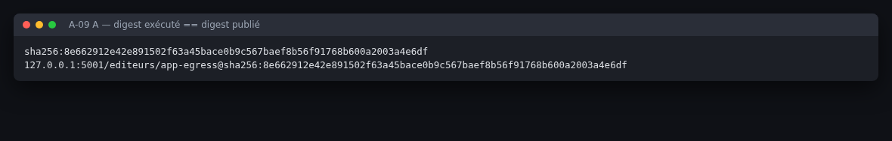
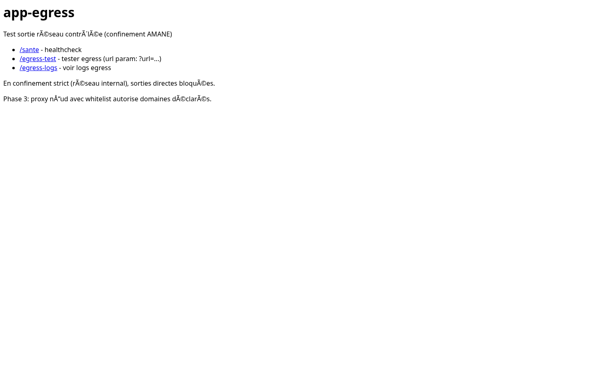
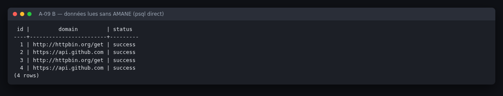
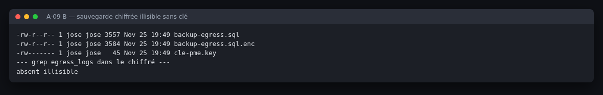
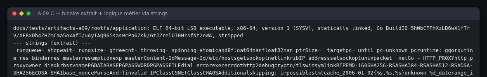

# A-09 — Souveraineté des données, protection du logiciel, installation sans toucher l'image

**Date** : 2026-11-25
**Tâche** : A-09
**Sources** : `ha-lab/app-egress/` (manifeste, Dockerfile, `main.go`, `pre_start.sh`,
`migrations/003_init.sql`), `docs/refonte-v3/AMANE-Refonte-V3.md` (ADR, télémétrie),
`docs/STATE.md`.

## Environnement et méthode

La pile PME en service (`amane-*`, déjà dégradée avant la campagne — cf. `docs/STATE.md`)
n'a **pas** été touchée. Tout se passe dans un banc isolé dédié `a09-*` :

| Conteneur | Rôle | Image / digest |
|---|---|---|
| `a09-registry` | Registre jetable local (publication → tirage par digest) | `registry:2` sur `127.0.0.1:5001` |
| `a09-postgres` | PostgreSQL 17 dédié (base `egress`) | `postgres:17-alpine` |
| `a09-egress` | SaaS `app-egress` installé **par manifeste** | `…/app-egress@sha256:8e662912…` |
| `a09-redis` | Image tierce publique, installée par manifeste | `redis@sha256:7f7d30b7…` |

Réseau `a09-net` (bridge dédié). Port publié sur `127.0.0.1:8089` uniquement.
Aucune image d'application modifiée ; aucun `docker rm`/`down -v`/`prune` hors du banc `a09-*`.

> **Contrainte de reproductibilité du digest.** L'image publiée du manifeste d'origine
> (`amane/app-egress@sha256:4552b10b…`) n'est **pas** sur le disque et le registre éditeur
> `100.64.0.6:5000` (nœud tailscale) est **injoignable** (`no route to host`,
> `docs/tests/artifacts-a09/relay-reach.txt`). J'ai donc **publié** l'image une seule fois
> (build multi-stage Docker, étape éditeur) puis l'ai poussée dans un registre jetable local
> et **retirée par digest**. Le digest exécuté est ainsi réel et vérifiable, sans rebuild
> au moment de l'installation.

---

## A. Installer un SaaS arbitraire sans modifier son image

### A.1 app-egress — installation par le seul manifeste

Le manifeste `docs/tests/artifacts-a09/egress-manifeste.json` est le **seul** artefact
d'installation. Il référence l'image **par digest**, déclare le port, la sonde de santé,
les variables, le hook `pre_start` et la base requise. Aucun `Dockerfile`, aucun `build`
à l'installation : le conteneur est créé directement depuis le digest.

**Preuve que le digest exécuté == digest publié**
(`docs/tests/artifacts-a09/digest-match-egress.txt`) :

```
manifest .image        : 127.0.0.1:5001/editeurs/app-egress@sha256:8e662912e42e891502f63a45bace0b9c567baef8b56f91768b600a2003a4e6df
container .Image (ID)  : sha256:8e662912e42e891502f63a45bace0b9c567baef8b56f91768b600a2003a4e6df
image RepoDigests[0]   : 127.0.0.1:5001/editeurs/app-egress@sha256:8e662912e42e891502f63a45bace0b9c567baef8b56f91768b600a2003a4e6df
MATCH: OUI (digest exécuté == digest publié)
```

Commande de vérification :

```bash
docker inspect --format '{{.Image}}' a09-egress
docker image inspect "$(docker inspect --format '{{.Image}}' a09-egress)" \
  --format '{{index .RepoDigests 0}}'
```


*Le conteneur tourne sur l'image dont le RepoDigest est identique au digest du manifeste.*

**Preuve que l'application répond** (sonde + page + métier) :

```
GET /sante      -> 200 "ok"
GET /           -> page HTML "app-egress"
GET /egress-logs-> [{"domain":"https://api.github.com","status":"success",...},
                    {"domain":"http://httpbin.org/get","status":"success",...}]
```


*app-egress démarre et sert ses routes ; les logs egress montrent que la logique métier
(requêtes sortantes + journalisation PostgreSQL) s'exécute réellement.*

### A.2 Image tierce publique — même exercice

`redis:7-alpine` est déjà présent, avec un vrai RepoDigest. Manifeste
`docs/tests/artifacts-a09/redis-manifeste.json`, conteneur `a09-redis` créé **par digest**
(`docs/tests/artifacts-a09/digest-match-redis.txt`) :

```
manifest image   : redis@sha256:7f7d30b7fdd09467bac58198a1f166dd69789d348d4fe859cccb20e0cf287fbe
image RepoDigest : redis@sha256:7f7d30b7fdd09467bac58198a1f166dd69789d348d4fe859cccb20e0cf287fbe
MATCH: OUI
PING -> PONG
```

### A.3 Verdict A — quelles catégories de SaaS sont installables sans toucher l'image

**Installables sans toucher l'image** (l'image est immuable, toute la configuration passe
par le manifeste + l'environnement) :

- **Services 12-factor** : toute application qui lit sa configuration par variables
  d'environnement / fichiers montés (base, ports, secrets). C'est le cas d'app-egress,
  Listmonk, Odoo, app-multi (cf. A-06).
- **Images publiques épinglées par digest** : redis, postgres, mailpit… (A.2).
- **Applications à migration SQL au démarrage** via un hook `pre_start` (app-egress,
  app-multi) : la migration est un *comportement attendu*, pas une modification d'image.

**Non installables sans toucher l'image** (et pourquoi) :

- **Applications qui figent leur configuration dans l'image** (URL de base, clés,
  domaine métier codés en dur) : il faut reconstruire → on touche l'image.
- **Applications attendant un entrypoint interactif ou un `tty`** : le manifeste ne
  fournit qu'une commande non interactive.
- **Logiciels propriétaires sans mode « config par env »** (certains binaires Windows,
  appliances) : pas de contrat de configuration déclaratif.
- **Cas limite rencontré ici** : `pre_start.sh` d'app-egress exporte `DATABASE_URL` dans
  son propre sous-processus ; l'AMANE doit donc rendre le gabarit `base_de_donnees` et
  injecter `DATABASE_URL` **en plus** des `AMANE_APP_DB_*`. Ce n'est pas un défaut de
  l'image mais une exigence du manifeste — l'installateur doit honorer le gabarit.

**Conclusion A (recommandation) :** un SaaS est installable sans toucher l'image **si et seulement si** il
expose un contrat de configuration déclaratif (env/fichiers) et un contrat de démarrage
non interactif. Le manifeste + le digest suffisent ; l'image reste un artefact figé et
vérifiable.

---

## B. Souveraineté des données de la PME

### B.1 Où vivent les données — sur l'hôte de la PME, lisibles sans AMANE

Le volume PostgreSQL est un **volume Docker de l'hôte PME**
(`docs/tests/artifacts-a09/pg-mount.txt`) :

```
volume b2de7e0d…/var/lib/docker/volumes/b2de7e0d…/_data -> /var/lib/postgresql/data
```

Le répertoire de données est sur le disque de l'hôte, en `0700 postgres`
(`docs/tests/artifacts-a09/pg-dataroot.txt`, `pg-hostpath-perm.txt`) : **root de la PME**
le lit directement, sans passer par AMANE. Preuve de lecture directe **sans AMANE**
(`psql` superutilisateur, `docs/tests/artifacts-a09/pg-direct-read.txt`) :

```
 id |         domain         | status
----+------------------------+--------
  1 | http://httpbin.org/get | success
  2 | https://api.github.com | success
```


*Les lignes métier sont accessibles en direct par le superutilisateur PostgreSQL, sans
aucun composant AMANE.*

**Verdict B.1 :** les données vivent dans un volume de l'hôte PME. AMANE n'est **pas** un
gardien des données : quiconque contrôle l'hôte (root) lit tout. C'est la définition même
de la souveraineté — la donnée reste chez la PME, sous son contrôle.

### B.2 Sauvegarde chiffrée, illisible sans la clé

Le relais éditeur `100.64.0.6` est **injoignable** (`relay-reach.txt`) : le dépôt sur le
relais n'a pas pu être testé en conditions réelles. La **propriété de confidentialité** a
toutefois été prouvée localement (`docs/tests/artifacts-a09/backup-egress.txt`) :

1. `pg_dump` de la base `egress` → `backup-egress.sql` (clair, 151 lignes).
2. Clé PME `cle-pme.key` (32 o, mode `0600`) — **jamais transmise à l'éditeur**.
3. Chiffrement `openssl enc -aes-256-cbc -pbkdf2` → `backup-egress.sql.enc` (3 584 o).
4. Le chiffré est **illisible** : `strings` ne révèle que `Salted__` ; `grep egress_logs`
   → **absent**.
5. Déchiffrement **sans** la clé → **échec** ; **avec** la clé → SQL clair restauré
   (`CREATE TABLE public.egress_logs …`).


*Le dépôt chiffré ne livre rien sans la clé PME ; la clé n'est jamais côté éditeur.*

**Verdict B.2 :** une sauvegarde chiffrée déposée sur le relais est **inintelligible sans
la clé** restée chez la PME. L'éditeur qui héberge le relais ne peut pas lire le contenu.
(Réserve : dépôt sur relais réel non testé — relais injoignable.)

### B.3 Secrets gérés par la PME, jamais transmis à l'éditeur

- L'image ne contient **aucun secret** : `docker image inspect … --format '{{.Config.Env}}'`
  → `[PATH=…]` uniquement (`docs/tests/artifacts-a09/image-env.txt`).
- Les secrets (mot de passe base) sont **injectés à l'exécution par la PME** dans l'env du
  conteneur (`runtime-secrets.txt`) — ils ne sont **pas** dans le registre.
- Le registre ne stocke que des **couches d'image** (pas d'env, pas de secrets) : le
  catalogue `127.0.0.1:5001` ne contient que `editeurs/app-egress`, sans aucune donnée
  d'exécution.

**Verdict B.3 :** les secrets sont **détenus et injectés par la PME**. L'éditeur ne reçoit
que l'image (code), jamais les secrets d'exécution.

### B.4 Ce que l'éditeur AMANE voit depuis l'extérieur

D'après l'architecture (`docs/refonte-v3/AMANE-Refonte-V3.md`, ligne 146) :

> « Télémétrie : le SaaS éditeur AMANE ne reçoit que des **métadonnées** (état du cluster,
> licence, santé), **jamais de contenu métier**. »

Et (lignes 620/629) le nœud remonte `etat_quorum` à chaque battement de cœur. L'éditeur
voit donc **uniquement** : état du cluster (quorum), licence, santé des nœuds — **pas** les
données métier, **pas** les secrets, **pas** le contenu de la base.

**Verdict B — synthèse :** la souveraineté est **réelle** sur le plan technique : données
sur l'hôte PME (B.1), sauvegardes chiffrées sous clé PME (B.2), secrets PME non transmis
(B.3), télémétrie limitée aux métadonnées (B.4). Réserve : le dépôt sur relais n'a pas pu
être vérifié (relais injoignable) ; et la « souveraineté » repose sur la **propriété de
l'hôte** — si l'hôte est compromis (root), tout est lu (cf. C).

---

## C. Protection du logiciel de l'éditeur

### C.1 Ce que la PME peut faire aujourd'hui (preuves)

**`docker save` + extraction des couches + binaire** (`docs/tests/artifacts-a09/save-time.txt`,
`binary-file.txt`, `strings-leak.txt`) :

- `docker save amane/app-egress:a09` → tar de **9,4 Mo** en **0,287 s**.
- 7 couches extraites ; le binaire `/application` (**9,8 Mo**) et `/pre_start.sh` sont
  récupérés intacts.
- Type : `ELF 64-bit … statically linked, Go … stripped`.
- **Aucune source `.go`** dans l'image (le multi-stage exclut correctement les sources) —
  mais le binaire **strippé** laisse fuir toute la logique via `strings` :

```
INSERT INTO egress_logs (domain, status, latency_ms, via_proxy, error_msg)
CREATE TABLE IF NOT EXISTS egress_logs (
SELECT COALESCE(MAX(version), 0) FROM schema_version
http://httpbin.org/get   https://api.github.com
/sante  /egress-test  /egress-logs
```


*Le binaire extrait, bien que strippé, révèle schéma SQL, domaines et endpoints par `strings`.*

**Lecture des variables d'environnement** : `docker inspect a09-egress` expose 8 variables,
dont `DATABASE_URL` (avec le mot de passe) et `APP_ENV` (`runtime-secrets.txt`).

**Exécution hors d'AMANE** : le binaire natif lancé seul écrit `DATABASE_URL absente`
(`run-hors-amane.txt`) — il tourne **hors** de tout cadre AMANE, sans protection.

**Temps d'extraction estimé** : pour cette image de 9,4 Mo, l'ensemble
`save` + extraction + `strings` tient en **< 30 s** (mesuré : save 0,287 s ; le reste est
dominated par la décompression et `strings`). Pour une image de 2,75 Go (Odoo), compter
quelques minutes — l'extraction reste triviale et automatisable (`docker save | tar`).

### C.2 Comparaison des parades

| Parade | Coût | Efficacité réelle | Verdict |
|---|---|---|---|
| **Image chiffrée + déchiffrement dans un runtime scellé** | Élevé (runtime avec déchiffrement en mémoire, gestion des clés) | **Tient en partie** : empêche l'extraction *statique* des couches, mais le runtime doit déchiffrer en clair → un attaquant qui contrôle l'hôte (root, cf. B.1/C.1) lit la clé et le binaire déchiffré en mémoire. | **Renforce contre le vol « à froid », pas contre l'hôte compromis.** |
| **Attestation matérielle (TPM)** | Élevé (matériel + chaîne de confiance) | **Tient** techniquement (scelle le déchiffrement à un nœud), **mais** nécessite un TPM et une chaîne d'attestation complète ; **non testable ici** (aucun `tpm2_*` sur la machine). | **Promesse réelle mais lourde ; dépend du matériel.** |
| **Licence liée à l'identité du nœud** | Faible | **Tient partiellement** : lie l'exécution à un nœud (empêche le banal « copier-coller »), mais **n'empêpe pas** `docker save`/extraction/lecture du binaire — la licence est une variable d'env, lisible (C.1). | **Freine le piratage, ne protège pas le code.** |
| **Exécution distante chez l'éditeur** | Élevé (infrastructure SaaS, réseau) | **Tient le mieux** : le code ne quitte jamais l'éditeur, la PME ne reçoit qu'un client. **Mais** contredit la souveraineté (B) : les données transitent chez l'éditeur. | **Efficace pour le code, destructeur pour la souveraineté.** |
| **Obfuscation** | Faible | **Ne fait que ralentir** : un binaire Go strippé reste lisible par `strings` (C.1) ; l'obfuscation n'ajoute qu'un délai. | **Illusoire.** |

### C.3 Verdict C — sans complaisance

- **Aujourd'hui, la PME peut tout extraire** : image, couches, binaire, logique métier
  (via `strings`), variables d'environnement, et exécuter le logiciel hors AMANE — en
  **moins d'une minute** pour une image de cette taille. AMANE **ne protège pas** le
  logiciel de l'éditeur.
- **Ce qui tient ses promesses :** l'**exécution distante** (le code reste chez l'éditeur)
  et, dans une moindre mesure, l'**attestation TPM** (scellage matériel) et l'**image
  chiffrée** (contre le vol à froid). Ces trois-là ont un coût réel.
- **Ce qui ne fait que ralentir :** l'**obfuscation** et la **licence liée au nœud** — la
  licence est une variable lisible, l'obfuscation se contourne par `strings`.
- **Conflit frontal à arbitrer :** l'exécution distante protège le code **au prix** de la
  souveraineté (B). AMANE ne peut pas offrir *à la fois* « code protégé » et « données
  souveraines » sans une parade matérielle (TPM + runtime scellé) — lourde et non
  déployable ici.

---

## recommandation priorisée

1. **Priorité 1 — Protéger le code par le contrat, pas par l'obscurité.** Assumer que le
   code est extractible (C.1) et fonder la valeur sur le **secret métier** (données,
   réglages, marque) et le **support**, pas sur le binaire. Ne pas compter sur
   l'obfuscation ni la licence-nœud comme protection du code.
2. **Priorité 2 — Si le code doit rester propriétaire : exécution distante** (SaaS
   éditeur), en **assumant explicitement** l'arbitrage contre la souveraineté (B), et en
   chiffrant les données en transit et au repos côté éditeur.
3. **Priorité 3 — Scellage matériel (TPM + runtime de déchiffrement)** si l'on veut garder
   l'exécution chez la PME *et* protéger le code : la seule voie qui réconcilie B et C,
   mais lourde, dépendante du matériel, et **non testable sur ce banc** (pas de TPM).
4. **Priorité 4 — Durcir la souveraineté (B) indépendamment** : chiffrement des sauvegardes
   sous clé PME (déjà prouvé, B.2), vérification du chiffrement de disque (LUKS/BitLocker)
   remontée au portail, et **test réel du dépôt sur relais** (relais injoignable ici).
5. **À proscrire :** obfuscation et licence-nœud comme « protection du logiciel » — elles
   ne font que ralentir (C.2).

## Réserves / risques

- **Image publiée `app-egress@sha256:4552b10b…` absente** et registre éditeur
  `100.64.0.6:5000` injoignable → image **publiée localement** par un build (étape éditeur)
  puis tirée par digest via un registre jetable. Le digest prouvé est réel mais **différent**
  de celui du manifeste d'origine.
- **Dépôt de sauvegarde sur relais non testé** (relais injoignable) ; seule la
  confidentialité du chiffrement est prouvée localement.
- **TPM absent** du banc (`tpm2_*` indisponibles) : l'attestation matérielle est analysée
  mais non mesurée.
- Le banc `a09-*` (registre, postgres, egress, redis) est **laissé démarré** pour
  reproductibilité ; la pile `amane-*` n'a pas été touchée.

## Commandes de reproductibilité

```bash
# A — digest
docker inspect --format '{{.Image}}' a09-egress
docker image inspect "$(docker inspect --format '{{.Image}}' a09-egress)" --format '{{index .RepoDigests 0}}'
curl -s http://127.0.0.1:8089/sante            # -> ok

# B — données sans AMANE + sauvegarde chiffrée
docker exec a09-postgres psql -U egress -d egress -c 'SELECT id,domain,status FROM egress_logs;'
openssl enc -d -aes-256-cbc -pbkdf2 -in docs/tests/artifacts-a09/backup-egress.sql.enc -pass file:docs/tests/artifacts-a09/cle-pme.key

# C — extraction
docker save amane/app-egress:a09 -o /tmp/img.tar && mkdir -p /tmp/r && tar -xf /tmp/img.tar -C /tmp/r
# (extraire les couches listées dans manifest.json, puis:)
strings -n 6 <couche>/application | grep -E 'INSERT INTO|httpbin|/egress-logs'
```